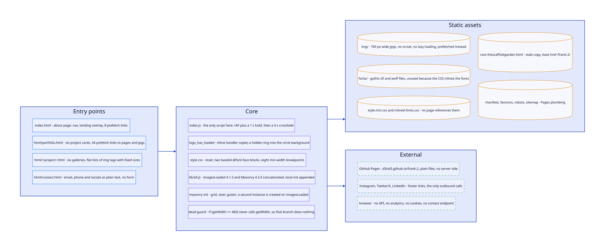

# HUMANS.md

The Frank Interior Design portfolio: seven hand-written HTML pages, one stylesheet and a single 46-line script, served straight off GitHub Pages with no build step.

## Read it left to right

- **There is no build.** Every page is committed HTML and CSS, and GitHub Pages hands it out as-is — so "production quality" here means the images were re-exported and the links were reordered, not that a pipeline exists. Changing the site means editing seven files by hand.
- **Loading is done with `<link rel="prefetch">` instead of a toolchain.** `html/portfolio.html` alone carries 44 prefetch hints: every project page and roughly forty JPEGs are queued the moment you open the work page, before you have clicked anything. The images themselves are fixed 760 px wide with no `srcset` and no lazy loading, so a phone downloads the desktop files eagerly.
- **Almost no JavaScript.** `index.js` exists only to crossfade a landing overlay: three nested `requestAnimationFrame` calls, a one-second hold, then a four-second opacity transition. The logo arrives through a `display:none` `` whose `onload` copies the file into the circle's CSS background, because background images cannot report when they have loaded.
- **Only one page needs the 31 KB bundle.** `html/thegingerpig.html` loads `lib/all.js` — imagesLoaded 4.1.3 and Masonry 4.2.0 concatenated, with local init appended — and that file ends up constructing the Masonry grid twice, once from a resize handler and once inside `imagesLoaded`. Its `if (getWidth >= 460)` branch never calls `getWidth`, so that breakpoint does nothing at all.
- **Two copies of the fonts.** `style.css` inlines both faces as base64 (185 KB, one blocking request), while `fonts/`, `inlined-fonts.css` and `style.min.css` are leftovers that no page references. The `thescaffoldgarden.html` in the repo root is a stale duplicate of `html/thescaffoldgarden.html` that uses an absolute `<base href="/frank-2/">`.

There is no contact endpoint: `html/contact.html` prints the email address and phone number as text, which is exactly what a static host can support.

---
Diagram source: [`docs/system.d2`](docs/system.d2) · render with [`scripts/render-diagram.sh`](scripts/render-diagram.sh) (writes `docs/system.svg` for light and dark, plus `docs/system.png`).
